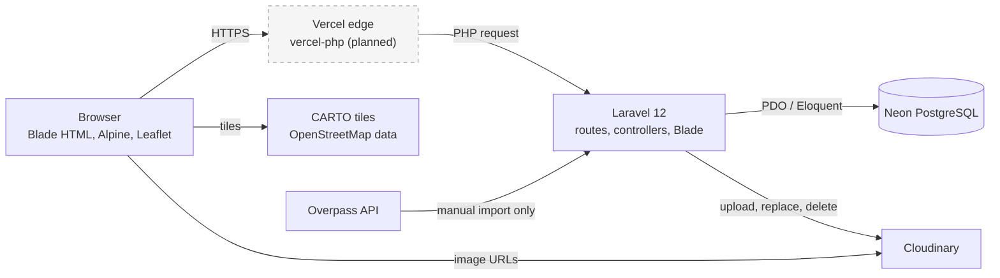
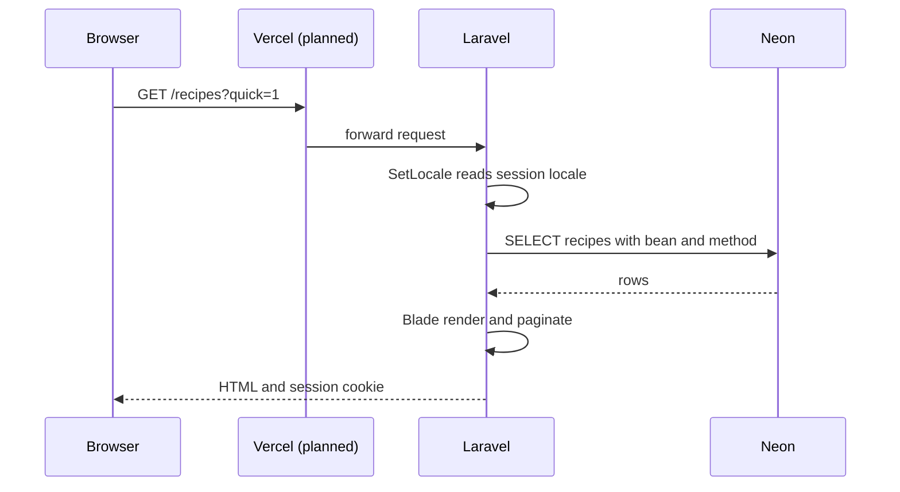
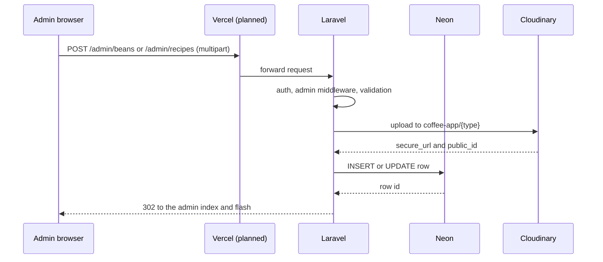
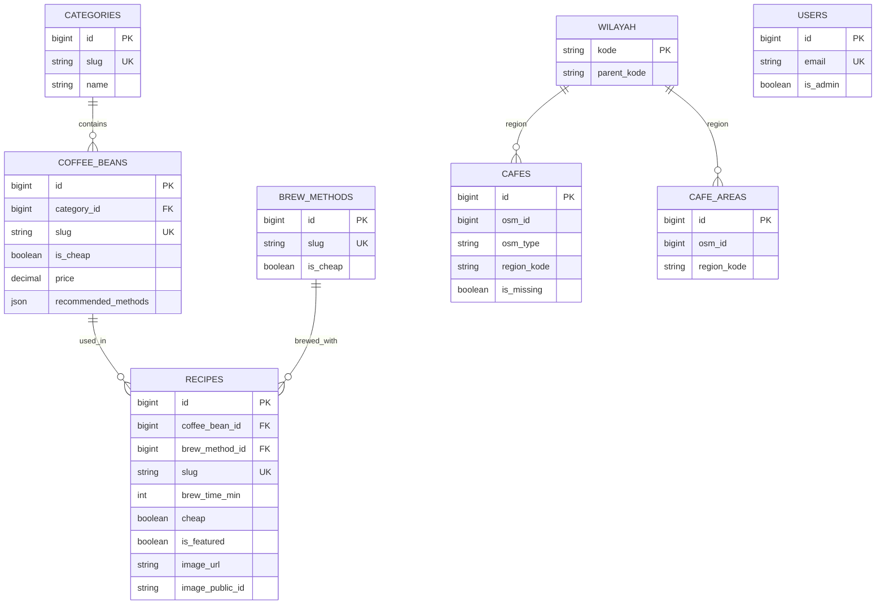

# Coffeebrewery Architecture

This document is a snapshot, not a rulebook. Change it when the stack changes, and record the date and reason in the Decision log at the bottom. Where this document and the code disagree, the code wins; mismatches are flagged in section 10. Verified against the repository on 16 November 2026; no secret values are listed.

## 1. Tech stack

Versions come from `composer.lock`, `package-lock.json`, or the file named in the row. `TBD` means the repo does not pin it.

| Layer | Tool | Version | Why it is here | Status |
|---|---|---|---|---|
| Runtime | PHP | `^8.2` constraint; local CLI 8.4.14 | Laravel 12 requirement | Active |
| Framework | Laravel | 12.70.0 | Routing, Eloquent, Blade views, auth, validation | Active |
| Interactivity | Alpine.js | 3.17.5 | Quiz, Surprise Me, map controls, menus | Active |
| Styling | Tailwind CSS | 4.3.3 | Utility classes and CSS-first theme tokens | Active |
| Build | Vite + laravel-vite-plugin | 7.3.7 / 2.1.0 | Separate `app` and `cafes` bundles | Active |
| Database | PostgreSQL | Version TBD; provider Neon | Relational catalog and cafe data | Active |
| Images | Cloudinary via `cloudinary-labs/cloudinary-laravel` | 3.0.2 | Remote image storage for serverless; currently in `require-dev` | Active |
| Map | Leaflet + markercluster, CARTO Positron tiles | 1.9.4 / 1.5.3; tiles unversioned | City pin clustering on a light basemap | Active |
| Animation | anime.js | 4.5.0 | Legacy reveals, count-up, wizard transitions; new motion uses CSS/native APIs | Active — removal candidate |
| Auth scaffold | Laravel Breeze | 2.4.2 | Login, password reset, profile views | Replaceable |
| Testing | PHPUnit | 11.5.57 | Feature and unit tests | Active |
| Hosting | Vercel with `vercel-php` | Runtime not pinned; latest npm `vercel-php` is 0.9.0 | Documented free PHP hosting plan | Planned |

## 2. System overview

Vercel is dashed because no deploy files exist in the repo. It is the documented plan, not the current code.

## 3. Request and data flow

### 3.1 Public page load

Example: a visitor opens `/recipes?quick=1`.

The controller sorts the quick filter by `brew_time_min` and paginates at 9. Vite assets and fonts load after the HTML. Leaflet is not loaded here; `cafes.js` and `bean-map.js` are separate Vite entries used only on `/cafes` and `/beans/{slug}`.

### 3.2 Admin saving content with an image

Beans, methods, and recipes all use the same path; recipes upload to `coffee-app/recipes`.

On edit, `CatalogWriter` uploads the new file before `CloudinaryUploader::replace()` deletes the old public id. On delete, `CatalogWriter` removes the row first and the image second; a foreign-key failure is caught and shown as a flash error, and an image failure only orphans the asset.

### 3.3 Admin CSV import

`CatalogImporter` reads the same file twice: `preview()` parses and validates without writing, `commit()` repeats the pass and writes inside one transaction. Both passes call `fieldRules()` on `StoreBeanRequest` / `StoreRecipeRequest`, so the preview and the commit cannot disagree and there is no second copy of the column rules. The uploaded file is copied to `sys_get_temp_dir()` and its path is kept in the session between the two steps.

- Match key is `slug`; a blank slug comes from the name/title. An existing slug updates that row, otherwise the row is created.
- Recipes resolve `bean_slug` and `method_slug` to ids; an unknown slug fails the row.
- Blank optional cells are dropped from the payload, so a re-import never clears an image, price, or unit.
- Limits: 500 rows, 1 MB, UTF-8, comma delimiter. Multi-value cells use `|`.
- Failed rows are returned in the result page and streamed as a CSV with a `reason` column. `image_url` is stored verbatim; the importer never calls Cloudinary.

### 3.4 JSON API contract

`routes/api.php` serves three same-origin endpoints. Their keys are a contract with `resources/js/app.js` and `resources/js/cafes.js`; `RecipeReadTest` and `CafeMapTest` assert the exact key sets, so a rename fails the suite instead of silently breaking the UI.

| Endpoint | Shape |
|---|---|
| `GET /api/cafes?bounds=s,w,n,e&region=` | `{data: [{id, name, lat, lng, area, hours, address, updated}]}` |
| `GET /api/recipes/random?cheap&quick&exclude&locale` | `{data: {id, title, slug, ratio, brew_time_min, water_temp, grind_size, bean: {name, category}, method: {name}, step_by_step}}` |
| `GET /api/recipes/suggest?ingredients&time&gear&taste&drink&locale` | `{data: [{…random summary fields, cheap, score}]}` |

There is no URL version prefix. The endpoints are internal and unversioned on purpose: versioning would add a second surface without protecting the only consumer, and the exact-key tests are the real guard.

## 4. System boundaries

| Boundary | What runs there | Allowed to touch |
|---|---|---|
| Browser | Blade HTML, Alpine state, Leaflet map, CSS animations | Public routes and APIs, tile URLs, font URLs, Cloudinary image URLs, Google Maps links. No database or Cloudinary credentials. |
| Vercel edge | TLS, routing, one PHP function (planned) | Request metadata, environment variables, function logs. Not durable disk. |
| Laravel | Routing, controllers, Form Requests, Blade, auth, admin, CLI imports | Neon through PDO, Cloudinary API, `/tmp`, environment. |
| Neon PostgreSQL | Catalog, cafe, session, cache, queue tables | Only the Laravel database user. The browser never connects. |
| Cloudinary | Bean, method, and recipe images | Laravel writes and deletes; the browser only reads returned URLs. The CSV import never calls Cloudinary. |
| CARTO and OpenStreetMap | Basemap tiles and OSM source data | The browser reads tiles. The import command reads Overpass. No user data is sent. |
| Bunny Fonts and Google Maps | Font files, directions page | Browser requests only. |

The CARTO tile key is embedded in `resources/js/cafes.js` and `config/coffee.php`. It is a client-side basemap key, not a server secret.

## 5. Folder structure

Only the folders that carry architectural weight.

| Path | Responsibility |
|---|---|
| `app/Http/Controllers/` | Public catalog, recipe, cafe, JSON API, admin, auth, and profile controllers; `Admin\ImportController` runs the CSV preview/commit flow |
| `app/Http/Middleware/`, `Requests/` | `SetLocale` (session on web, `?locale=` on the stateless API); `EnsureUserIsAdmin`; `CafeMapRequest` and the admin form requests, whose static `fieldRules()` is shared with the importer |
| `app/Http/Resources/` | `CafeResource`, the stable pin payload for `cafes.js` |
| `app/Models/` | `Category`, `CoffeeBean`, `BrewMethod`, `Recipe`, `Cafe`, `CafeArea`, `Wilayah`, `User` |
| `app/Services/`, `Console/Commands/` | `CatalogWriter` and `CloudinaryUploader`; `CatalogImporter` (CSV preview and commit); `RecipeMatcher`; `CafeImporter`, `AreaAssigner`, `OverpassClient`; `wilayah:import` and `import:cafes` |
| `app/Rules/` | `UniqueSlug`, shared by the four admin form requests |
| `app/Support/` | `CafeMapPage` (café cascade, counts, bounds, bootstrap); `RecipeSeo` (meta, share image, Recipe JSON-LD) |
| `bootstrap/app.php`, `config/` | Routing, middleware aliases, and app/database/session/cache/`cafes.php`/`coffee.php` config |
| `database/migrations/`, `seeders/` | 14 migrations including session, cache, and job tables; seed catalog and admin |
| `lang/` | Indonesian JSON and auth/password translation files |
| `resources/css/`, `resources/js/` | Tailwind entry and tokens; `cafes.css` (loaded by the `cafes.js` entry); `app.js`, `cafes.js`, `bean-map.js`, `easing.js`, `bootstrap.js` |
| `resources/views/` | `layouts`, `components`, `public`, `admin`, `auth`, `profile` |
| `routes/` | `web.php`, `api.php`, `auth.php`, `console.php` |
| `public/build/` | Generated Vite output (ignored by git) |
| `tests/` | Feature and unit tests; SQLite in memory |
| `docs/` | Implementation plan, UI redesign plan, cafe audit and build plan |

## 6. Data model

Core tables and key columns. Timestamps and most display columns are omitted for readability.

Relations:

- `categories` 1 to many `coffee_beans`; `coffee_beans` and `brew_methods` each 1 to many `recipes`. `recipes` requires both parents, and both foreign keys use `restrictOnDelete`.
- `coffee_beans.recommended_drinks` and `recommended_methods` are nullable JSON arrays of drink names and `brew_methods.slug` values. They are display hints only, so there is no pivot table and no foreign key.
- `recipes.image_url` and `image_public_id` mirror the bean columns and are written by `CatalogWriter` from the recipe form; the CSV importer stores `image_url` verbatim and leaves `image_public_id` null.
- `wilayah` stores official province and city/regency codes. `parent_kode` points to a province row; it is not a database foreign key.
- `cafes.region_kode` and `cafe_areas.region_kode` match `wilayah.kode` logically, with no constraint. Cafes carry address, hours, raw OSM tags, `area_name`, and `last_seen_at`; rows upsert by `(osm_id, osm_type)` and are flagged `is_missing`, never deleted.
- Framework tables not shown: `sessions`, `cache`, `cache_locks`, `jobs`, `job_batches`, `failed_jobs`, `migrations`, `password_reset_tokens`.

## 7. Localization

- English is the source language and the default (`APP_LOCALE=en`, fallback `en`). There is no `lang/en.json`; English strings are the keys passed to `__()`.
- Indonesian lives in `lang/id.json`, with `lang/id/auth.php` and `lang/id/passwords.php` for framework messages. Missing keys fall back to English.
- `GET /locale/{locale}` accepts only `en` or `id`, writes `session('locale')`, and redirects back. `SetLocale` runs on every web request and calls `App::setLocale()`. URLs have no locale prefix, so both languages share one canonical URL; the switcher adds `hreflang` markup only.
- JSON routes live in `routes/api.php` under `/api/*` and use the stateless `api` middleware group. `SetLocale` therefore reads `?locale=` there (falling back to `Accept-Language`), normalises `id-ID`/`en_US` to the base language, and `app.js`/`cafes.js` send `window.APP_LOCALE` with every API request so translated steps survive the missing session.
- Stored content is English only. Recipe steps call `__($step)`, so a step translates only when its exact English text is a key in `id.json`. There are no per-locale columns and no content translation table.

## 8. Environment variables

No values are shown. "Local" means the untracked `.env`; "Vercel" means the dashboard plan in `docs/implementation_plan.md`.

| Name | Purpose | Where it is set |
|---|---|---|
| `APP_NAME`, `APP_ENV`, `APP_DEBUG`, `APP_URL`, `APP_KEY` | App identity, environment, debug, canonical URL, encryption | Local; Vercel |
| `APP_LOCALE`, `APP_FALLBACK_LOCALE` | Default and fallback language | Local |
| `DB_CONNECTION`, `DB_HOST`, `DB_PORT`, `DB_DATABASE`, `DB_USERNAME`, `DB_PASSWORD`, `DB_SSLMODE` | Neon connection | Local; Vercel |
| `SESSION_DRIVER`, `SESSION_LIFETIME`, `SESSION_SECURE_COOKIE`, `CACHE_STORE`, `QUEUE_CONNECTION` | Session, cache, and queue backends; no queue worker exists | Local; Vercel |
| `FILESYSTEM_DISK` | Default Laravel disk; Cloudinary uses its own package | Local |
| `CLOUDINARY_URL` | Cloudinary credentials | Local; Vercel; missing from `.env.example` |
| `ADMIN_EMAIL`, `ADMIN_PASSWORD`, `LOG_CHANNEL`, `VITE_APP_NAME` | Seed admin, log destination, Vite app name | Local; admin keys missing from `.env.example` |

Local state differs from the example file: `.env.example` sets SQLite with database session, cache, and queue; the local `.env` uses `pgsql` and points at Neon. A new developer who copies `.env.example` gets SQLite, not the tracked architecture.

## 9. Deployment

### Current state

There is no `vercel.json`, no `api/index.php`, no `.vercel` directory, no Dockerfile, and no CI workflow. Deployment is **planned, not reproducible from this repo**. `docs/implementation_plan.md` describes files that are not present, so that section is stale. This is the main code-versus-notes mismatch.

### Documented plan

1. Add `api/index.php` that requires `public/index.php`, plus `vercel.json` that routes all requests to it and pins a `vercel-php` runtime.
2. Build assets with `npm run build`; `public/build` is generated on deploy and is not tracked in git.
3. Run migrations from a trusted machine against Neon with `php artisan migrate --force --seed`. Do not run migrations on deploy; there is no migration step in code, and who audits this is TBD.
4. Set environment variables in the Vercel dashboard, including `CLOUDINARY_URL` and the Neon credentials.

### Runtime limits

Vercel Functions limits checked 6 November 2026:

| Limit | Hobby value |
|---|---|
| Request or response body | 4.5 MB |
| Bundle, memory, CPU | 250 MB uncompressed; 2 GB / 1 vCPU |
| Maximum duration | 300 s |
| Writable disk | Read-only except `/tmp`, up to 500 MB |
| Per deployment | 12 functions; 64 KB total environment variables |

`vercel-php` runs PHP's built-in development server inside one function. It supports PHP 7.4 to 8.5; the latest published npm version is 0.9.0, which targets PHP 8.5. The community repository was archived on 29 October 2026, so this plan has maintenance risk. The repo pins no runtime version; the exact pin is TBD.

### Admin access

Current restriction is `auth` plus the `admin` middleware checking `users.is_admin`. The planned IP allowlist on Vercel is **not implemented**: there is no IP middleware, no allowlist config, and no Vercel WAF rule in the repo.

## 10. Known limits and risks

- **Hosting is unverified and undocumented in code.** No Vercel files exist. The `vercel-php` runtime is archived and maintained by one community project. Pin a version or move to the official Docker/FrankenPHP path before launch. The planned IP allowlist is also absent; `/admin` relies on login plus `is_admin`.
- **Cloudinary is a dev dependency.** It is in `require-dev`, but admin image uploads need it in production. `composer install --no-dev` drops the package and breaks uploads.
- **Cold starts and ephemeral disk.** Vercel archives idle functions; Neon free tiers can pause. File sessions, file cache, and compiled views cannot persist, and current defaults use database sessions and cache, adding a write per request.
- **Upload ceiling.** Vercel accepts 4.5 MB per request. The admin image rule is 4 MB, close to the edge; larger files fail before Laravel validates them.
- **CSV import keeps a temp file between two requests.** `ImportController` copies the upload to `sys_get_temp_dir()` and stores the path in the session, so preview and commit must land on an instance that shares that disk. That holds locally and on a single container, but not necessarily on Vercel Functions, where `/tmp` is per-instance. Keep the import on one instance or move the pending file to object storage before relying on it in production.
- **No queue worker or scheduler.** `QUEUE_CONNECTION` defaults to database and there is no worker. Catalog and cafe imports are manual CLI commands, which blocks background jobs.
- **Database connections.** Every warm function instance can open its own Neon connection. Use a pooled endpoint and check the connection ceiling; the production topology is TBD.
- **Content is English only in the database.** Indonesian covers interface strings and exact-match stored strings. New recipes, beans, and methods are not localized.
- **Map dependency.** CARTO tiles need the client key and attribution; the fallback if it is revoked is TBD. OSM import also depends on an external Overpass instance.
- **The JSON API is an internal, unversioned contract.** `/api/*` serves only the same-origin scripts and has no client auth or version prefix; the payload keys are pinned by feature tests, so changing them is a breaking change for `app.js` and `cafes.js`.
- **No analytics, error tracking, or CI.** There is no Sentry, product analytics, uptime check, or workflow file in the repo; tests and migrations run locally.
- **anime.js is retained for legacy effects only.** The Surprise roll, Brew Finder step transitions, count-up, and scroll reveals still use it. New motion is CSS, View Transitions, or scroll-driven CSS; do not add new anime.js calls. Removing the dependency is a later pass, not part of the current redesign.

## 11. How to change the stack

### Swap the database provider

1. Set `DB_CONNECTION=pgsql` and fill `DB_HOST`, `DB_PORT`, `DB_DATABASE`, `DB_USERNAME`, `DB_PASSWORD`, and `DB_SSLMODE`.
2. Review driver-specific migrations, then run `php artisan migrate --seed` and the SQLite test suite.
3. Move existing rows if this is not a fresh database, then update this document, the env table, and the risks.

### Swap hosting

1. Add the new platform's entry point and rewrite rules, or remove the Vercel files once they exist.
2. Choose writable paths (`/tmp` or object storage) and set session and cache drivers accordingly.
3. Add migrations, a queue worker, and a scheduler to the deploy step or CI.
4. Recheck body limits, function duration, memory, and TLS/domain settings.
5. Keep admin protection at least at `auth` plus `is_admin`; add the IP allowlist at the edge or in middleware.

### Swap the image provider

1. Replace `CloudinaryUploader` calls inside `CatalogWriter`; preserve the upload-then-delete order and keep `image_url` plus `image_public_id`.
2. Move the new SDK to `require`, not `require-dev`; update credentials and remove the old package.
3. Update SEO tests that assert Cloudinary URLs, verify the browser can read new URLs, and migrate old images.

## Decision log

| Date | Decision | Reason |
|---|---|---|
| 2026-10-21 | Laravel 12 + Breeze + Cloudinary scaffold; catalog schema and admin CMS | Initial build, then first feature set (`6aaba9e`, `1a8c34b`) |
| 2026-10-22 | Public catalog, quiz, and quick-brew flow | Version 1 feature set (`02330b1`) |
| 2026-10-27 | Frontend upgrade: Tailwind 4.3, anime.js v4, EN/ID, View Transitions, SEO/JSON-LD | CSS-first tokens, motion, wider audience (`f9129c5`, `f7f7ede`, `4717f66`, `6158354`) |
| 2026-10-30 | OSM cafe import and `/cafes` map | Local cafe discovery (`9f7f014`, `b13d5fa`) |
| 2026-11-01 | CARTO Positron tiles and map polish | Lighter basemap and clearer popups (`75d0d1a`, `23d0eac`) |
| 2026-11-02 | UI redesign phases 1 and 2 | Shared tokens, home and bean detail (`56580c1`, `73335eb`, `7074edb`) |
| 2026-11-06 | PRD and architecture documents | Onboarding and decision record |
| 2026-11-16 | Admin CSV import, recipe images, `recommended_methods` | Bulk catalog entry with one validation source; manual Cloudinary upload for recipes; method hints on beans |
| TBD (planned) | Vercel with `vercel-php`; admin IP allowlist | Free PHP hosting and extra `/admin` protection, not yet in code |
