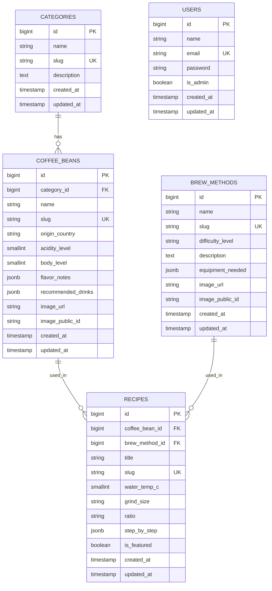

# Coffee Knowledge & Recipe Platform: Implementation Plan

**Goal:** A Laravel website that catalogs coffee beans, brew methods and recipes, with a "Surprise Me" random recipe popup and an admin CMS to manage all content.

**Estimate:** 17 to 24 hours total for one developer who already knows Laravel. Add about 50% if Alpine.js, Cloudinary or running PHP on Vercel are new to you.

---

## 1. Scope

**Public site**
- Bean catalog with category filter and a detail overlay on each card
- Brew methods list and detail pages
- Recipes list and detail pages
- "Surprise Me" popup that shows a random recipe

**Admin CMS**
- Login (single admin account, no public registration)
- Create, edit, delete for categories, beans, brew methods and recipes
- Image upload to Cloudinary from the bean and method forms

**Out of scope for v1** (assumed, edit if wrong): public user accounts, ratings, comments, search.

---

## 2. Tech Stack

| Layer | Choice | Notes |
|---|---|---|
| Backend | Laravel (pin the current stable major in `composer.json`) | Check the PHP minimum before you start. Eloquent, auth and routing are built in. |
| Frontend | Blade + Alpine.js | Alpine handles the modal, the overlay toggle and the fetch call. No SPA needed. |
| Styling | Tailwind CSS | Check which major version your install pulls in. Section 3 shows both setups. |
| Database | Managed PostgreSQL (Neon or Supabase) through the `pgsql` driver | Set `sslmode=require`. Free tiers can pause when idle, so the first query after a pause is slow. Check current limits before choosing. |
| Media | Cloudinary via `cloudinary-labs/cloudinary-laravel` | Store both `secure_url` and `public_id` so you can delete old images. |
| Hosting | Vercel (free) with the `vercel-php` community runtime | PHP is not officially supported on Vercel, and the runtime rests on one maintainer. The disk is read-only, so caches go to `/tmp`, sessions use cookies and migrations run from your machine. Fallback if it breaks: Render free (Docker), which sleeps after 15 minutes idle. |
| Domain | `coffee.zaidanghiffari.my.id` | Add the domain in Vercel (Project, Settings, Domains) first, then create the DNS record Vercel shows you. |

---

## 3. Design Tokens

| Token | Hex | Use |
|---|---|---|
| `coffee-espresso` | `#2C1A14` | Headings, body text, navbar background |
| `coffee-mocha` | `#6F4E37` | Borders, sub-headings |
| `coffee-latte` | `#FDFBF7` | Page background |
| `coffee-amber` | `#C87D55` | Buttons, active states, hover highlights |
| `coffee-cream` | `#F4EBE1` | Card fill, subtle containers |
| `coffee-roast` | `#4A2C21` | Dark cards, hover overlays |

**Contrast rule:** put `coffee-espresso` text on `coffee-amber` buttons (about 5.2:1). White on amber is about 3.2:1 and fails WCAG AA for normal-size text.

**Tailwind v4** (colors live in CSS, `resources/css/app.css`):

```css
@import "tailwindcss";

@theme {
  --color-coffee-espresso: #2C1A14;
  --color-coffee-mocha: #6F4E37;
  --color-coffee-latte: #FDFBF7;
  --color-coffee-amber: #C87D55;
  --color-coffee-cream: #F4EBE1;
  --color-coffee-roast: #4A2C21;
}
```

**Tailwind v3** (colors live in `tailwind.config.js`):

```javascript
theme: {
  extend: {
    colors: {
      coffee: {
        espresso: '#2C1A14',
        mocha: '#6F4E37',
        latte: '#FDFBF7',
        amber: '#C87D55',
        cream: '#F4EBE1',
        roast: '#4A2C21',
      }
    }
  }
}
```

---

## 4. Database Schema



**Rules for the schema**
- `acidity_level` and `body_level`: integers from 1 to 5 (enforce in the Form Request and with a DB check constraint).
- `difficulty_level`: one of `easy`, `medium`, `hard`.
- Foreign keys use `restrictOnDelete()`. Deleting a bean that still has recipes fails with a clear error instead of silently removing recipes.
- JSON columns use `jsonb()` and are cast to `array` in the models.
- `water_temp_c` is an integer. The view appends the degree sign.
- `users.is_admin` defaults to `false`. The seeded admin gets `true`.

---

## 5. Routes

| Method | Path | Purpose |
|---|---|---|
| GET | `/` | Home: hero, catalog preview, methods |
| GET | `/beans` | Catalog, filter with `?category=arabica` |
| GET | `/beans/{slug}` | Bean detail |
| GET | `/recipes`, `/recipes/{slug}` | Recipe list and detail |
| GET | `/methods`, `/methods/{slug}` | Method list and detail |
| GET | `/api/recipes/random?exclude={id}` | Random recipe as JSON, throttled |
| ANY | `/admin/*` | Resource routes for beans, recipes, methods, categories. Middleware: `auth` + `admin` |

`/register` is disabled. Only the seeded admin can log in.

---

## 6. Wireframes

### 6.1 Public: Homepage and Bean Catalog

```
┌────────────────────────────────────────────────────────────────────────────────────────┐
│  HEADER / NAVBAR (Sticky, Dark Espresso Background)                                    │
│  [☕ CoffeeHub]        Home    Bean Catalog    Recipes    Brew Methods    [Admin Login] │
├────────────────────────────────────────────────────────────────────────────────────────┤
│  HERO SECTION                                                                          │
│  "Discover the Art of Coffee & Flavor Profiles"                                         │
│  [Explore Beans]  [🎲 Surprise Me Recipe]                                              │
├────────────────────────────────────────────────────────────────────────────────────────┤
│  BEAN CATALOG SECTION                                                                  │
│  Filter: [ All ] [ Arabica ] [ Robusta ] [ Liberica ]                                  │
│                                                                                        │
│  ┌────────────────────────┐  ┌────────────────────────┐  ┌────────────────────────┐  │
│  │ ☕ Sidama Guji          │  │ ☕ Toraja Kalosi       │  │ ☕ Gayo Aceh           │  │
│  │ Origin: Ethiopia       │  │ Origin: Indonesia      │  │ Origin: Indonesia      │  │
│  │ Acidity: ★★★★☆         │  │ Acidity: ★★☆☆☆         │  │ Acidity: ★★★☆☆         │  │
│  │ [HOVER/TAP: Details    │  │ [HOVER/TAP: Details    │  │ [HOVER/TAP: Details    │  │
│  │  overlay shows Flavor  │  │  overlay shows Flavor  │  │  overlay shows Flavor  │  │
│  │  Notes, Body, Serving] │  │  Notes, Body, Serving] │  │  Notes, Body, Serving] │  │
│  └────────────────────────┘  └────────────────────────┘  └────────────────────────┘  │
├────────────────────────────────────────────────────────────────────────────────────────┤
│  BREW METHODS SECTION                                                                  │
│  ┌──────────────┐  ┌──────────────┐  ┌──────────────┐  ┌──────────────┐                 │
│  │ V60 Drip     │  │ French Press │  │ Aeropress    │  │ Espresso     │                 │
│  └──────────────┘  └──────────────┘  └──────────────┘  └──────────────┘                 │
├────────────────────────────────────────────────────────────────────────────────────────┤
│  FOOTER                                           © 2026 Zaidan Ghiffari | CoffeeHub   │
└────────────────────────────────────────────────────────────────────────────────────────┘
```

Desktop: the overlay opens on hover. Touch: tapping a card toggles the overlay.

### 6.2 "Surprise Me" Modal

```
┌───────────────────────────────────────────────────────────────────┐
│ 🎲 RANDOM RECIPE GENERATOR                                  [ X ] │
├───────────────────────────────────────────────────────────────────┤
│                                                                   │
│  ✨ Recommended Pairing:                                          │
│  "Iced V60 Guji Citrus Bloom"                                     │
│                                                                   │
│  • Bean Type:   Ethiopia Sidama Guji (Arabica)                    │
│  • Method:      V60 Pour Over                                     │
│  • Ratio:       1 : 15 (18g Coffee / 270g Water)                  │
│  • Temp:        92°C                                              │
│  • Grind Size:  Medium-Fine                                       │
│                                                                   │
│  Step-by-Step Instructions:                                       │
│  1. Rinse paper filter with hot water.                            │
│  2. Pour 50g water for 30s bloom.                                 │
│  3. Continue spiral pour until 270g target is reached.            │
│                                                                   │
│  [ 🎲 Roll Another Recipe ]                 [ View Full Recipe ]  │
└───────────────────────────────────────────────────────────────────┘
```

States to build: loading, error ("Could not load a recipe. Try again."), empty (no recipes in the database).

### 6.3 Admin Dashboard

```
┌──────────────────────────────────────────────────────────────────────┐
│  ┌──────────────┐  ┌─────────────────────────────────────────────┐   │
│  │  Coffee CMS  │  │  Dashboard Overview                         │   │
│  │  ──────────  │  │  ───────────                                │   │
│  │  📊 Overview  │  │  ┌──────────┐ ┌──────────┐ ┌──────────┐    │   │
│  │  🫘 Beans     │  │  │  Beans   │ │ Recipes  │ │ Methods  │    │   │
│  │  📖 Recipes   │  │  │    12    │ │    24    │ │    6     │    │   │
│  │  ☕ Methods   │  │  └──────────┘ └──────────┘ └──────────┘    │   │
│  │  📂 Categories│  │                                             │   │
│  │              │  │  Recent Bean Additions                      │   │
│  │  ← Logout    │  │  + Add New Coffee Bean Button               │   │
│  │              │  │  [Table: Name | Category | Origin | Actions]│   │
│  └──────────────┘  └─────────────────────────────────────────────┘   │
└──────────────────────────────────────────────────────────────────────┘
```

---

## 7. File Map

```
coffee-app/
├── app/
│   ├── Http/
│   │   ├── Controllers/
│   │   │   ├── Admin/
│   │   │   │   ├── BeanController.php
│   │   │   │   ├── CategoryController.php
│   │   │   │   ├── MethodController.php
│   │   │   │   └── RecipeController.php
│   │   │   ├── Api/
│   │   │   │   └── RandomRecipeController.php
│   │   │   ├── CatalogController.php
│   │   │   └── RecipePublicController.php
│   │   ├── Middleware/
│   │   │   └── EnsureUserIsAdmin.php
│   │   └── Requests/Admin/
│   │       ├── StoreBeanRequest.php
│   │       ├── StoreCategoryRequest.php
│   │       ├── StoreMethodRequest.php
│   │       └── StoreRecipeRequest.php
│   ├── Models/
│   │   ├── BrewMethod.php
│   │   ├── Category.php
│   │   ├── CoffeeBean.php
│   │   └── Recipe.php
│   └── Services/
│       └── CloudinaryUploader.php
├── database/
│   ├── migrations/            (timestamped by artisan)
│   └── seeders/
│       ├── DatabaseSeeder.php
│       ├── AdminUserSeeder.php
│       ├── CategorySeeder.php
│       ├── CoffeeBeanSeeder.php
│       ├── BrewMethodSeeder.php
│       └── RecipeSeeder.php
├── resources/
│   ├── css/app.css
│   └── views/
│       ├── components/
│       │   ├── bean-card.blade.php
│       │   ├── surprise-modal.blade.php
│       │   └── navbar.blade.php
│       ├── public/
│       │   ├── home.blade.php
│       │   ├── beans/{index,show}.blade.php
│       │   ├── recipes/{index,show}.blade.php
│       │   └── methods/{index,show}.blade.php
│       └── admin/
│           ├── layout.blade.php
│           ├── dashboard.blade.php
│           └── {beans,recipes,methods,categories}/{index,create,edit}.blade.php
├── routes/
│   ├── web.php
│   └── api.php                (run `php artisan install:api` if missing)
├── tests/Feature/
│   ├── RandomRecipeTest.php
│   └── AdminAccessTest.php
├── api/
│   └── index.php              (Vercel entry, requires public/index.php)
├── public/build/              (Vite output, committed to git)
└── vercel.json
```

---

## 8. Phases

### Phase 1: Setup and Database (2 to 3 hours)

1. Create the Laravel project and set up Tailwind with Vite (section 3).
2. Create the cloud database. Set `DB_CONNECTION=pgsql` and the host, user, password and `sslmode=require` in `.env`.
3. Run `php artisan migrate` once now to confirm the connection. If you see prepared statement errors, you are on a transaction-mode pooler. Switch to the direct or session-mode connection string.
4. Write the four migrations and add `is_admin` to `users`. Add models with relationships (`belongsTo`, `hasMany`), `jsonb` casts and the `restrictOnDelete` rules.
5. Write seeders: 1 admin (credentials from `.env`), 3 categories, 6 beans (include Gayo, Toraja, Sidama), 4 methods, at least 8 recipes. The randomizer needs variety to feel random.

**Done when:** `php artisan migrate:fresh --seed` finishes with no errors.

### Phase 2: Admin CMS (6 to 8 hours)

1. Install Laravel Breeze (Blade stack). Remove the register routes and views.
2. Add the `EnsureUserIsAdmin` middleware (checks `is_admin`), register the `admin` alias (in `bootstrap/app.php` on Laravel 11 and later), and wrap all `/admin` routes in `auth` + `admin`.
3. Write the four Form Requests. Key rules: `acidity_level` and `body_level` as `integer|between:1,5`, `flavor_notes` as `array|max:8` with each item a string up to 40 characters, `slug` unique, `step_by_step` with at least one step, `image` as `image|mimes:jpg,jpeg,png,webp|max:4096`.
4. Build the four resource controllers and their views (index, create, edit).
5. Build `CloudinaryUploader`. On create or replace, upload and save `secure_url` and `public_id`. On replace or delete, remove the old asset by `public_id`.

**Done when:** you log in as admin, create a bean with a photo, and see the row in the table and the file in Cloudinary.

### Phase 3: Public Frontend (6 to 8 hours)

1. Build the layout: sticky navbar and footer with the coffee palette.
2. Build `bean-card`. Use `group-hover` for desktop and an Alpine `open` flag toggled on click for touch. Overlay shows origin, flavor notes, body and recommended drinks. Card height must not change when the overlay opens.
3. Build the catalog page with a server-side category filter (`?category=`). It works without JavaScript.
4. Build the methods list and detail pages with the equipment list.
5. Build "Surprise Me":
   - Route: `GET /api/recipes/random?exclude={id}` with `throttle:30,1`.
   - Query: `Recipe::with(['coffeeBean', 'brewMethod'])->when($exclude, fn ($q) => $q->whereKeyNot($exclude))->inRandomOrder()->first()`.
   - Return an API Resource. Return a 404 JSON body when no recipe exists.
   - Alpine fetches, shows loading and error states, and sends the current recipe id as `exclude` when you click "Roll Another".

**Done when:** all three bean cards open their overlay on hover (desktop) and on tap (375px viewport), and "Roll Another" never repeats the same recipe twice in a row.

### Phase 4: Test and Deploy on Vercel (3 to 5 hours)

1. Write two feature tests: the random endpoint returns 200 with seeded data and 404 with an empty table; a guest is redirected from `/admin` and a non-admin user gets 403.
2. Add Vercel files. `api/index.php` requires `public/index.php`. `vercel.json` routes all requests to `api/index.php` with the `vercel-php` runtime (check the latest release and pin it) and sets the env vars in step 3.
3. Set Vercel-safe env vars: `APP_CONFIG_CACHE`, `APP_ROUTES_CACHE`, `APP_SERVICES_CACHE`, `APP_PACKAGES_CACHE` and `APP_EVENTS_CACHE` pointing to `/tmp`, `VIEW_COMPILED_PATH=/tmp/views`, `SESSION_DRIVER=cookie`, `LOG_CHANNEL=stderr`, `CACHE_STORE=array`.
4. Run `npm run build` locally and commit `public/build`. Run `php artisan migrate --force --seed` from your machine against the cloud database. Do not run migrations on deploy.
5. Import the repo in Vercel. Add `APP_KEY`, `APP_ENV=production`, `APP_DEBUG=false`, `APP_URL`, the database variables and the Cloudinary URL in the dashboard. Add the domain `coffee.zaidanghiffari.my.id`. Force HTTPS in `AppServiceProvider` (`URL::forceScheme('https')`). Run Lighthouse in mobile mode and fix anything below the targets in section 9.

**Done when:** `https://coffee.zaidanghiffari.my.id` loads, admin login works, and an image upload works on the live site.

---

## 9. Acceptance Criteria

- [ ] **Data:** `php artisan migrate:fresh --seed` exits with code 0 on an empty database.
- [ ] **Overlay:** At 1280px wide, hovering a card shows the overlay with no layout shift. At 375px wide, tapping a card toggles it.
- [ ] **Randomizer:** With 8 or more recipes, 20 clicks on "Roll Another" never show the same recipe twice in a row. Each result shows ratio, temperature and grind size. The JSON response returns in under 1 second on the live site.
- [ ] **Upload:** A 3 MB JPG uploads in the admin. `image_url` starts with `https://res.cloudinary.com/`. Replacing the image removes the old file from Cloudinary.
- [ ] **Admin security:** A guest visiting any `/admin` URL is redirected to login. A non-admin user gets 403. `/register` returns 404.
- [ ] **Responsive:** No horizontal scroll at 320px wide.
- [ ] **Performance:** Lighthouse mobile scores at least 80 for Performance and 90 for Accessibility on the live URL.

---

## 10. Decisions to Confirm

1. **Hosting (decided):** Vercel free with `vercel-php`. Check Vercel's free plan terms if the site ever earns money.
2. **Recipe authorship:** The draft had a Users to Recipes link but no column to back it. It is removed. Add `user_id` back if more than one admin needs credit on recipes.
3. **Dashboard counts:** The wireframe shows 12 beans, 24 recipes and 6 methods. Those are placeholders. The real numbers come from the database.

---

## Changes From Your Draft

- Fixed the Mermaid diagram: `erdiagram` is now `erDiagram`, and each `timestamps` entry became `created_at` and `updated_at` with types.
- Renamed model `Bean` to `CoffeeBean` so Laravel finds the `coffee_beans` table. The query now uses `coffeeBean`.
- Added `users.is_admin`, an admin middleware and disabled registration. Your draft had an `AdminAuth` middleware with nothing to check.
- Added `slug` to recipes (needed for "View Full Recipe"), `image_public_id` to beans and methods (needed to delete old images), and changed `water_temp` from a string to `water_temp_c` (integer).
- Removed "Media" from the admin sidebar. Uploads happen inside the bean and method forms, and no controller existed for it.
- Added the missing files: Form Requests, `CloudinaryUploader`, `DatabaseSeeder`, edit and show views, Vercel entry files, tests.
- Replaced "Render / Fly.io" with Vercel and `vercel-php` (your choice). Fly.io has no free tier for new accounts. Docker files are gone from the file map.
- Added tap support for the overlay, because hover does not exist on touch screens and your own criteria require 320px mobile.
- Added time estimates, "Done when" checks and measurable acceptance criteria.
